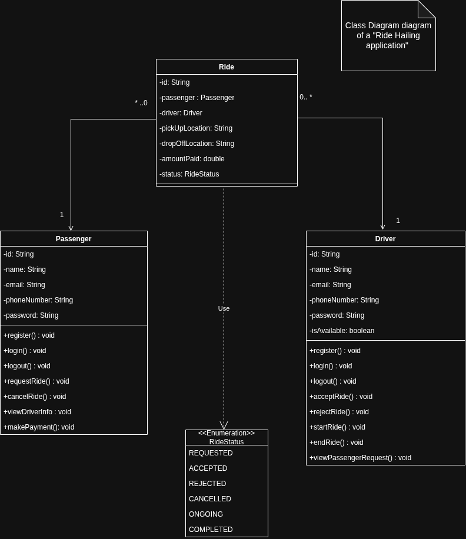

# RideApp – Ride Hailing backend

Spring Boot + MongoDB REST API implementing the class diagram in [`docs/class-diagram.png`](docs/class-diagram.png).



## UML → code

| UML | Code |
|---|---|
| `Passenger` (+register, login, logout, requestRide, cancelRide, viewDriverInfo, makePayment) | `data/models/Passenger`, `services/PassengerService(Impl)`, `controllers/PassengerController` |
| `Driver` (+register, login, logout, acceptRide, rejectRide, startRide, endRide, viewPassengerRequest) | `data/models/Driver`, `services/DriverService(Impl)`, `controllers/DriverController` |
| `Ride` (* → 1 Passenger, * → 1 Driver) | `data/models/Ride` (references stored as `passengerId` / `driverId`) |
| `<<Enumeration>> RideStatus` | `data/models/RideStatus` |

Deliberate small differences from the diagram:
* `Ride.passenger` / `Ride.driver` are stored as ids instead of embedded objects, so password hashes are never copied into ride documents.
* `Driver.isAvailable` is the field `available` (`isAvailable()` getter).
* `Passenger` and `Driver` have an extra `loggedIn` flag, set by `login()` and cleared by `logout()`. Ride operations require it (HTTP 401 otherwise). There are no tokens/JWTs yet.
* Added `PATCH /api/drivers/{id}/availability` so a driver can go on/off duty.

## Ride lifecycle

```
REQUESTED ──accept──▶ ACCEPTED ──start──▶ ONGOING ──end──▶ COMPLETED ──pay──▶ (amountPaid set)
    │  └──reject──▶ REJECTED     │
    └──────cancel──▶ CANCELLED ◀─┘
```

* When a passenger requests a ride, the first **available and logged-in** driver is assigned (status `REQUESTED`). No driver → `409`.
* The driver then accepts or rejects it. Accepting makes the driver unavailable; ending or cancelling frees them.
* A passenger can only have one active ride (`REQUESTED`/`ACCEPTED`/`ONGOING`).
* Payment is allowed once, only for a `COMPLETED` ride.

## API

All responses look like `{"successful": true|false, "data": ...}`. Errors: `400` validation, `401` bad credentials / not logged in, `404` unknown (or someone else's) resource, `409` invalid state.

| Method & path | Body | Notes |
|---|---|---|
| `POST /api/passengers/register` | `{name,email,phoneNumber,password}` | 201 |
| `POST /api/passengers/login` | `{email,password}` | |
| `POST /api/passengers/logout` | `{userId}` | |
| `POST /api/passengers/{id}/rides` | `{pickUpLocation,dropOffLocation}` | requestRide, 201 |
| `GET  /api/passengers/{id}/rides` | | ride history |
| `POST /api/passengers/{id}/rides/{rideId}/cancel` | | cancelRide |
| `GET  /api/passengers/{id}/rides/{rideId}/driver` | | viewDriverInfo (after acceptance) |
| `POST /api/passengers/{id}/rides/{rideId}/payment` | `{amount}` | makePayment |
| `POST /api/drivers/register` · `/login` · `/logout` | same as passenger | |
| `PATCH /api/drivers/{id}/availability` | `{available}` | |
| `GET  /api/drivers/{id}/requests` | | viewPassengerRequest |
| `POST /api/drivers/{id}/rides/{rideId}/accept` · `reject` · `start` · `end` | | |

Passwords are hashed with BCrypt (`spring-security-crypto` only – no security filter chain is added). Emails are trimmed and lower-cased.

## Running

```bash
# MongoDB on localhost:27017 (or change spring.mongodb.uri in application.properties)
docker run -d -p 27017:27017 mongo:7.0
mvn spring-boot:run
```

## Tests

Integration tests start the real application on a random port against a real MongoDB in a
[Testcontainers](https://testcontainers.com) container (`mongo:7.0`, one container shared by all test classes) and call the REST API.
**Docker must be running.**

```bash
mvn test
```

* `PassengerIntegrationTest`, `DriverIntegrationTest` – register / login / logout / validation / hashing
* `RideFlowIntegrationTest` – full ride lifecycle, rejection, cancellation, permissions, payment rules
* `RideRepositoryIntegrationTest` – derived Mongo queries
* `RideAppApplicationContextTest` – context smoke test

## Requirements
Java 25 (see `java.version` in `pom.xml`), Maven 3.9+, Docker for the tests.
